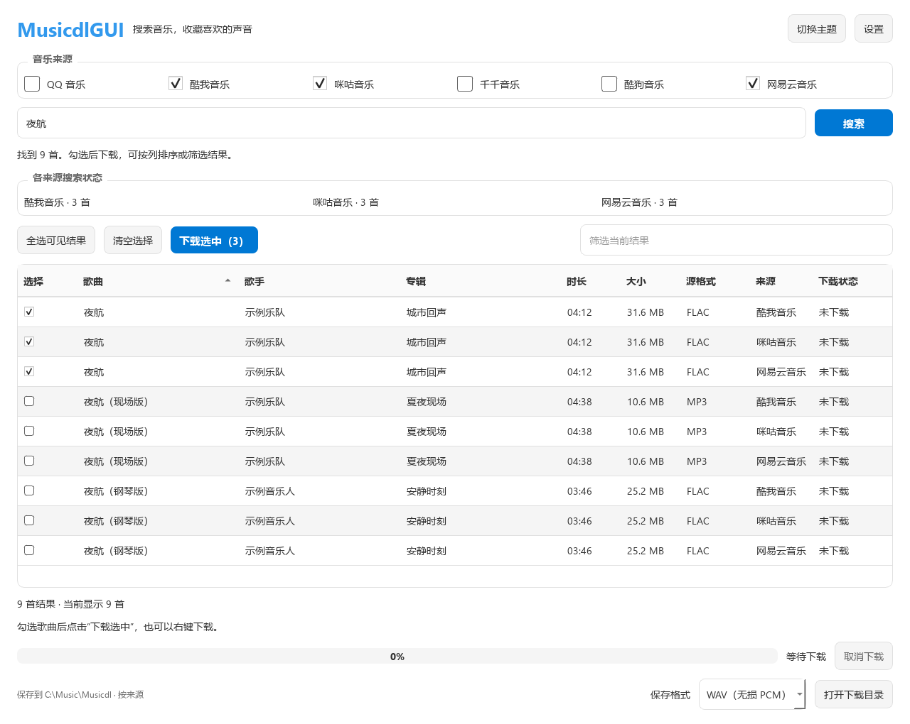
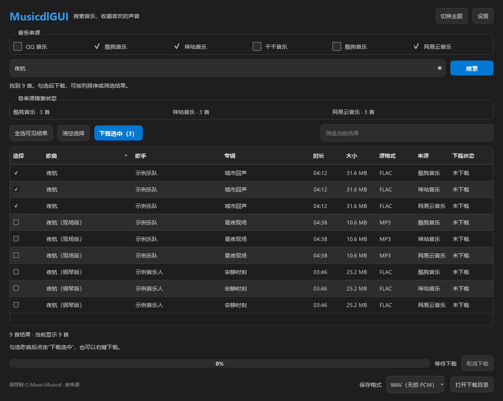
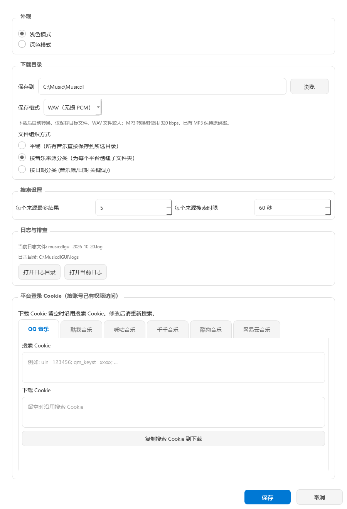
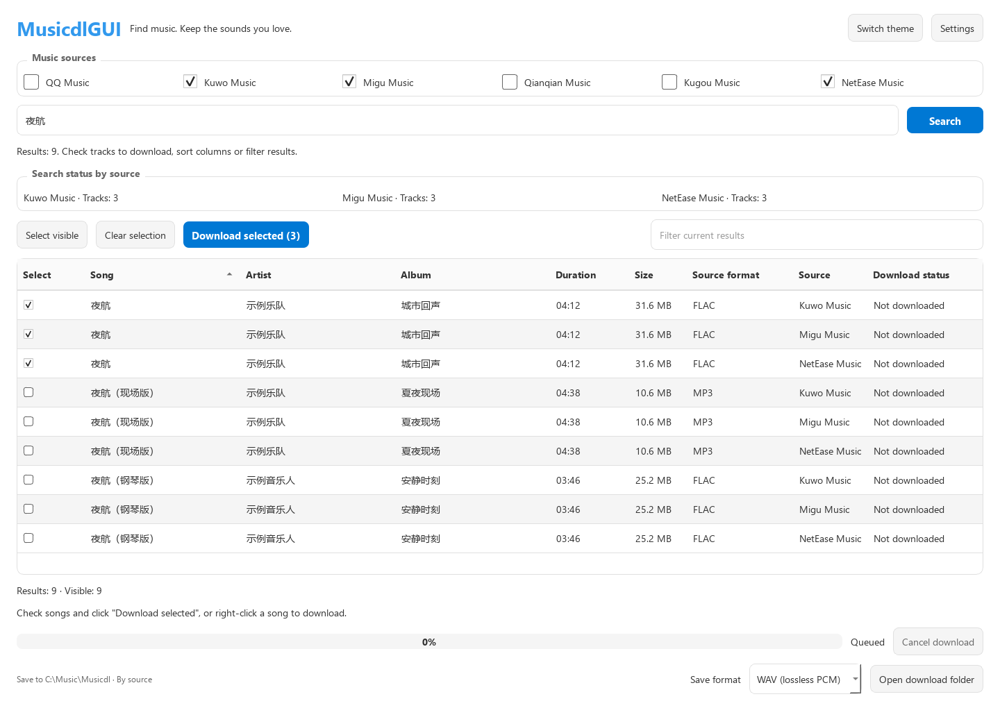

<div align="center">

# MusicdlGUI

**简体中文** | [English](README.en.md)

**搜索音乐，收藏喜欢的声音。**

一个基于 [musicdl](https://github.com/CharlesPikachu/musicdl) 与 PyQt5 的音乐搜索、下载桌面工具。

在一个窗口里搜索多个音乐来源，筛选并批量下载，再按需保存为原格式、WAV 或 MP3。

[](requirements.txt)
[](requirements.txt)
[](https://github.com/CharlesPikachu/musicdl)
[](LICENSE)
[](https://github.com/MorseWayne/musicdl-gui/releases/tag/v1.3.0)

[快速开始](#快速开始) · [功能一览](#功能一览) · [界面预览](#界面预览) · [English UI](#interface-language) · [使用指南](#使用指南) · [常见问题](#常见问题)

</div>



<p align="center"><sub>当前版本界面，使用离线示例数据展示；实际搜索结果与可用格式以音乐平台返回为准。</sub></p>

> 本项目仅供学习和教育使用，不得用于商业用途。请遵守音乐平台条款及版权规定，完整说明见[免责声明与许可证](#免责声明与许可证)。

## 功能一览

| 从搜索到保存 | 你可以做什么 |
| --- | --- |
| **多个来源，一起搜索** | 支持 QQ、酷我、咪咕、千千、酷狗、网易云；各来源独立搜索，结果陆续显示。 |
| **更快找到想要的版本** | 按歌名、歌手或专辑搜索，再筛选当前结果；点击列头比较时长、大小、格式与来源。 |
| **勾选后，批量下载** | 支持单首、批量和右键下载，逐首显示状态，失败歌曲可单独重试。 |
| **保存为你需要的格式** | 保留原格式，或在下载后自动转换为 WAV / MP3，无需另外安装 FFmpeg 命令。 |
| **文件有序保存** | 支持平铺、按来源、按来源/日期和关键词分类；同名文件自动编号，避免覆盖。 |
| **任务进展看得见** | 各来源有独立状态与错误提示，支持超时、取消、失败重试和日志排查。 |
| **按自己的习惯使用** | 简体中文与 English 界面、浅色与深色主题、快捷键、可配置搜索数量和时限，以及按平台设置的 Cookie。 |

默认选择 **酷我、咪咕、网易云**，最多同时搜索三个来源；每个来源默认最多 5 首、60 秒时限，可在设置中调整。平台可用性会受网络、登录状态和上游接口变化影响。

## 界面预览

### 深色模式：专注浏览搜索结果



点击右上角的“切换主题”即可切换浅色与深色模式。歌曲的源格式和底部的保存格式分别显示，便于在下载前确认。

<details>
<summary><strong>展开查看设置界面：保存格式、目录组织与搜索偏好</strong></summary>



目录、格式和搜索偏好可在同一处配置；日志入口与各平台 Cookie 设置也在这里。截图中的路径为示例，Cookie 未填写。

</details>

## 快速开始

### Windows 直接运行

从 [v1.3.0 发布页](https://github.com/MorseWayne/musicdl-gui/releases/tag/v1.3.0) 下载 `MusicdlGUI-Windows-x64.zip`，**完整解压**后运行 `MusicdlGUI.exe`。无需安装 Python 或 FFmpeg。当前官方发布包为 Windows x64，未提供已验证的 x86、macOS 或 Linux 安装包；macOS / Linux 可尝试下方的源码运行方式。

发布页同时提供 `SHA256SUMS.txt`。可用 PowerShell 的 `Get-FileHash .\MusicdlGUI-Windows-x64.zip -Algorithm SHA256` 与其中的哈希核对。升级时使用新目录解压，用户配置和已有下载目录会保留。

首次使用见[快速开始指南](QUICKSTART.md)，本次变更见[更新日志](CHANGELOG.md)。

### 从源码运行

需要 **Python 3.10+**，建议使用 **Python 3.11 / 3.12 x64**。本项目当前适配并固定 `musicdl==2.14.0`、`PyQt5==5.15.11`。

先克隆仓库，或下载源码后进入项目目录：

```bash
git clone https://github.com/MorseWayne/musicdl-gui.git
cd musicdl-gui
```

创建虚拟环境：

```bash
python -m venv .venv
```

**Windows PowerShell**：

```powershell
.\.venv\Scripts\python.exe -m pip install -r requirements.txt
.\.venv\Scripts\python.exe check_env.py
.\.venv\Scripts\python.exe musicdlgui.py
```

**Linux / macOS**：

```bash
.venv/bin/python -m pip install -r requirements.txt
.venv/bin/python check_env.py
.venv/bin/python musicdlgui.py
```

Linux 需要可用的图形桌面与 Qt 系统运行库。如果报 `xcb` 插件错误，请先检查系统图形依赖。

### Windows 安装包与构建

可在 [Releases](https://github.com/MorseWayne/musicdl-gui/releases) 查看已发布的安装包。旧版安装包内置的音乐源接口可能已失效；更新仓库不会更新旧的 exe。需要当前功能时，请从源码运行，或按 [Windows 构建指南](BUILD.md) 重新构建。

## 使用指南

<a id="interface-language"></a>

### 切换语言 / Interface language

点击右上角 **设置 / Settings**，在设置页顶部的 **语言 / Language** 中选择 **English** 或 **简体中文**，然后点击 **Save / 保存**。设置页可即时预览语言，保存后主界面立即切换，无需重启；已有搜索结果和勾选状态会保留，下次启动沿用所选语言。取消设置不会改变主界面的语言。

**English:** Open **Settings (设置 / Settings)** → **Language (语言 / Language)** → **English** → **Save**. The interface switches immediately and remembers your choice for the next launch. Song titles, artist names and other platform metadata stay as provided by the music source.

v1.3.0 已包含语言切换功能。旧 exe 不会随仓库更新，请下载新版发布包、从当前源码运行或重新构建。

<details>
<summary>English interface preview (offline example data)</summary>



</details>

### 三步保存喜欢的音乐

1. **搜索**：选择音乐来源，输入歌名、歌手或专辑，按 `Enter`。结果会陆续显示，各来源状态独立更新。
2. **选择**：点击列头排序，用“筛选当前结果”缩小范围，再勾选需要的歌曲。未勾选时可下载高亮选中的行，也可以右键下载单首。
3. **保存**：在底部选择保存格式，点击“下载选中”。下载状态逐首更新，完成后点击“打开下载目录”查看文件；失败后可重试。

| 快捷操作 | 用途 |
| --- | --- |
| `Enter` | 在搜索框中发起搜索 |
| `Ctrl+L` | 聚焦搜索框 |
| `Esc` | 取消当前任务 |
| 全选可见结果 | 只勾选筛选后可见的歌曲 |
| 重试失败来源 / 重试失败下载 | 只重试失败的来源或歌曲 |

搜索时点击“取消搜索”，下载时点击“取消下载”，也可以按 `Esc`。
取消搜索保留已有结果；取消下载清理当前临时文件，并停止后续队列。关闭窗口会先停止后台任务再退出。

**选择提示**：已勾选的歌曲即使被筛选隐藏，仍计入“下载选中”的数量。

### 选择保存格式

主界面底部和设置中的“保存格式”均可选择，适用于单首和批量下载。

| 保存格式 | 保存方式与取舍 |
| --- | --- |
| **保留原格式**（默认） | 保留平台返回的音频，不进行格式转换。 |
| **WAV（无损 PCM）** | 保留采样率、声道和解码后的精度，文件通常会变大；24 位 FLAC 使用 32 位 PCM 保存。 |
| **MP3（有损压缩）** | 转换使用 320 kbps；超过双声道时混合为立体声，采样率适配至 32 / 44.1 / 48 kHz。 |

例如将 FLAC 下载为 WAV：选择“保存格式 → WAV（无损 PCM）”，再勾选歌曲下载。
下载完成后会自动转换，界面显示“转换中”和进度；完成后只保存目标格式文件。

- 转换不会提升原音质，升级后也不会自动转换已有文件。
- 文件实际已经是目标格式时直接保留，避免重复有损编码。转换会检查真实音频内容，不仅修改扩展名。
- 转换期间可取消或关闭窗口，临时原文件和未完成目标文件都会清理；转换失败会显示原因，重试将重新下载。
- 使用 PyAV wheel 内置的 FFmpeg 库，无需另外安装 `ffmpeg` 命令。源码环境请按 [requirements.txt](requirements.txt) 安装完整依赖。

### 设置与文件保存

- **下载目录**：新安装默认保存到用户音乐目录下的 `Musicdl`。支持平铺、按来源、按来源/日期和关键词分类；同名文件自动追加编号，不覆盖已有音乐。下载通过完整性检查后才保存正式文件。
- **平台 Cookie**：按平台配置，下载 Cookie 留空时沿用搜索 Cookie。修改后重新搜索才能应用，仅能访问账号已有权限内的内容。
- **配置与日志**：设置保存在系统用户配置目录的 `MusicdlGUI/settings.json`，日志在系统用户数据目录的 `MusicdlGUI/logs/`，可从设置中打开。
- **旧设置迁移**：首次启动会读取并迁移程序旁的旧 `settings.json`，保留原文件和下载目录。旧相对路径按旧设置文件所在目录解析。
- **凭据保存**：设置中的 Cookie 是本机明文凭据，请勿分享该文件。旧夸克 Cookie 值会保留；当前六个来源没有夸克入口，界面不再显示这一无效配置项。

## 常见问题

### 某个来源搜索失败或没有结果

界面会保留每个来源的错误说明，并允许只重试失败来源。没有可下载结果与请求失败分别显示。
部分平台会受网络、登录状态或上游接口变化影响；默认时限包含该来源初始化和音乐地址解析的时间。

可运行限时联网诊断（不读取个人 Cookie，不下载歌曲）：

```bash
python check_env.py --search "晴天" --timeout 60 --limit 5
python check_env.py --search "晴天" --sources MiguMusicClient,KuwoMusicClient
```

请使用前面创建的虚拟环境中的 Python。诊断退出码：`0` 环境正常且搜索有结果，`1` 环境或参数错误，`2` 搜索未得到可用结果。
如果只有某一个来源超时，可以先切换其他来源，或在设置中延长时限。下载链接过期时应重新搜索后下载。

### 当前支持哪些下载方式

目前支持六个平台的 HTTP 直链音频；不支持 HLS 播放列表、DRM 解密或音频预览。付费或需要登录的内容仍受账号自身权限限制。

## 开发与验证

```bash
python -m pip install -r requirements.txt pytest
python -m pytest -q
```

测试覆盖 musicdl 数据适配、真实子进程取消和超时、Cookie 传递、HTTP 下载、WAV / MP3 实际编码、转换取消、完整文件保存、设置迁移、排序选择与批量队列。
Qt 测试使用 offscreen 模式，不需要显示器；联网平台可用性由上述诊断命令单独验证。

| 模块 | 职责 |
| --- | --- |
| `musicdlgui.py` | 主界面、结果选择与下载队列 |
| `backend.py` | 音乐平台适配与文件传输 |
| `audio_conversion.py` | 流式音频转换 |
| `workers.py` | 限时子进程与后台任务 |
| `app_config.py` | 设置存储、迁移与用户目录 |
| `i18n.py` | 中英文界面文案、即时切换与后台任务语言 |

Windows 构建与打包验收见 [BUILD.md](BUILD.md)。源码测试不代表 Windows 打包产物已经验收。

## 免责声明与许可证

本项目仅供学习和教育使用，不得用于商业用途。不托管或分发任何受版权保护的内容。
如需访问付费曲目，请购买或订阅相关音乐服务，请勿绕过付费限制或 DRM。

本仓库代码采用 [MIT License](LICENSE)；依赖 musicdl 的使用与分发须遵守其自身许可证。

感谢 [musicdl](https://github.com/CharlesPikachu/musicdl) 作者 Charles 的皮卡丘，为本项目提供音乐平台适配能力。
